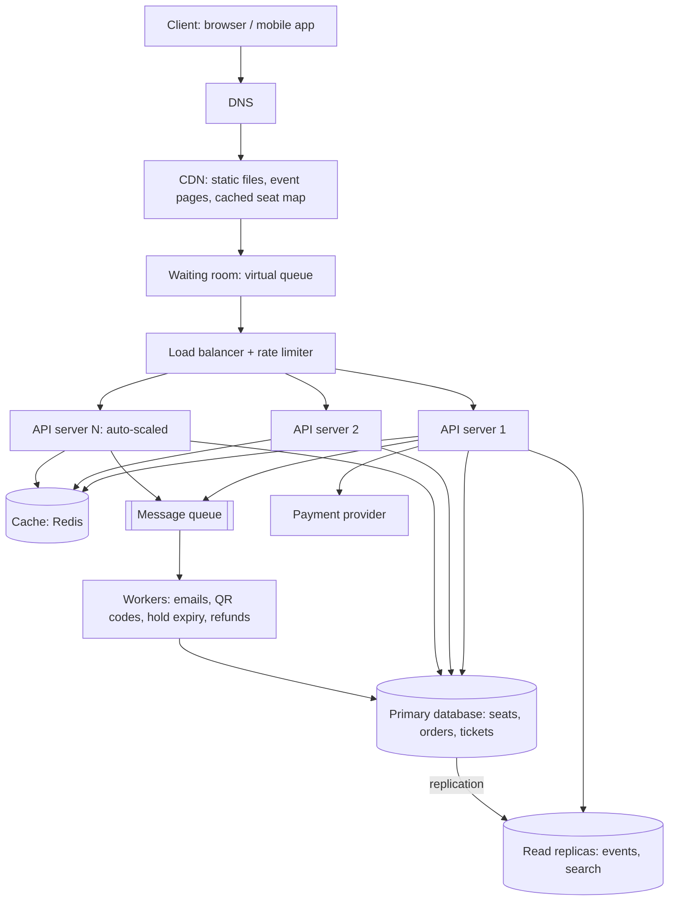

# TicketHub: Event Ticketing System Design

TicketHub is a website that sells tickets for concerts and events. This document follows the six-part framework: requirements, estimates, API, data model, architecture and trade-offs. It also explains, in its own section, how two people are prevented from buying the same seat.

## 1. Requirements

### Functional

- Users register, log in and log out.
- Users browse and search upcoming events (by name, city, date).
- Users view an event and its seat map, with each seat's price and availability.
- Users **hold** up to 4 seats for a short time (10 minutes) while they pay.
- Users pay for held seats and receive an order confirmation.
- Users view their tickets (with a QR code) and their past orders.
- Held seats that are not paid for are released automatically.
- Organisers create events and set the seats and prices (admin side, out of scope here).

### Non-functional

- **Speed:** browsing pages respond in under 300 ms (p95); holding a seat responds in under 500 ms, even during a big sale.
- **Correctness (most important):** a seat is never sold to two people, and a customer is never charged without getting a ticket (or refunded). Correctness always wins over speed.
- **Fairness:** people are served in the order they arrived; one user cannot hog seats (limit of 4 per order and per event); bots are slowed down.
- **Availability:** browsing stays up at 99.9% even if the payment provider or a server fails.
- **Scalability:** handle a normal day cheaply and a 1,000x spike for a few minutes.
- **Security:** HTTPS, hashed passwords, card details never stored on our servers (handled by the payment provider).
- **Durability:** paid orders are never lost (replicated database, backups).

## 2. Estimates

Given: 2 million registered users; 50,000 visitors on a normal day, each viewing 10 pages; 5,000 tickets sold on a normal day; for a popular sale, 200,000 people try to buy 20,000 seats within the first 10 minutes.

### Normal day

| Metric | Calculation | Result |
|--------|-------------|--------|
| Page views per day | 50,000 x 10 | 500,000 |
| Page views per second (average) | 500,000 / 86,400 | ~6 /s |
| Page views per second (peak, 5x average) | 6 x 5 | ~30 /s |
| Tickets sold per second (average) | 5,000 / 86,400 | ~0.06 /s (about 1 every 17 s) |

A single small server could handle this.

### Big sale (first 10 minutes = 600 seconds)

Assumptions: each of the 200,000 users makes about 20 requests during the 10 minutes (open the event, load the seat map a few times, try to hold seats, pay); an average of 3 hold attempts per user because seats are taken while they choose.

| Metric | Calculation | Result |
|--------|-------------|--------|
| Users arriving per second | 200,000 / 600 | ~333 /s |
| Total requests per second | 200,000 x 20 / 600 | ~6,700 /s |
| Seat-map reads (if the page refreshes every 5 s) | 200,000 / 5 | up to ~40,000 /s |
| Hold attempts per second | 200,000 x 3 / 600 | ~1,000 /s |
| Seats sold per second (at least) | 20,000 / 600 | ~33 /s |
| Demand vs supply | 200,000 / 20,000 | 10 people per seat |

### Comparison

| | Normal day | Big sale | Increase |
|---|-----------|----------|----------|
| Requests per second | ~6 (peak ~30) | ~6,700 | ~1,000x (about 200x the normal peak) |
| Tickets sold per second | ~0.06 | ~33 | ~500x |
| Time window | 24 hours | 10 minutes | traffic is squeezed into 0.7% of the day |

Conclusions: (1) a design sized for a normal day would collapse in the sale, and one sized for the sale would waste money all year, so the system must **scale up and down** and **shield the database**; (2) the spike is read-heavy (seat maps) and extremely **contended** (thousands of people fighting for the same rows); (3) 9 out of 10 people will not get a seat, so the system must fail them quickly and politely, not slowly.

## 3. API

Base path `/v1`, JSON, bearer token for everything except browsing.

| # | Method | Path | Description | Success |
|---|--------|------|-------------|---------|
| 1 | GET | `/events?city=&date=&q=&cursor=` | Browse and search events (paginated) | 200 |
| 2 | GET | `/events/{eventId}` | Event details | 200 |
| 3 | GET | `/events/{eventId}/seats?section=` | Seat map with each seat's status | 200 |
| 4 | POST | `/events/{eventId}/holds` | Hold seats for 10 minutes | 201 |
| 5 | DELETE | `/holds/{holdId}` | Release a hold early | 204 |
| 6 | POST | `/orders` | Pay for a hold and create the order (needs `Idempotency-Key` header) | 201 |
| 7 | GET | `/orders/{orderId}` | View one order | 200 |
| 8 | GET | `/me/tickets` | View my tickets | 200 |
| 9 | POST | `/auth/login` | Log in | 200 |

### Hold seats

`POST /v1/events/55/holds`

```json
{ "seatIds": [10231, 10232] }
```

Response `201 Created`:

```json
{
  "holdId": "h_8f21c",
  "eventId": 55,
  "seatIds": [10231, 10232],
  "expiresAt": "2026-11-20T18:10:00Z"
}
```

If any seat is gone, nothing is held and the API replies `409 Conflict`:

```json
{ "error": { "code": "SEAT_UNAVAILABLE", "message": "Seat 10232 was just taken. Please choose another seat.", "seatIds": [10232] } }
```

### Pay

`POST /v1/orders` with header `Idempotency-Key: 6c1f...`

```json
{ "holdId": "h_8f21c", "paymentToken": "tok_abc123" }
```

Response `201 Created`:

```json
{ "orderId": 7001, "status": "PAID", "total": 15000, "currency": "KES", "tickets": [{ "ticketId": 9001, "seatId": 10231 }, { "ticketId": 9002, "seatId": 10232 }] }
```

Other status codes: `400` invalid input, `401` not logged in, `403` hold belongs to someone else, `404` unknown event or hold, `409` seat unavailable, `410 Gone` hold expired, `402 Payment Required` payment declined, `429` too many requests (rate limit or waiting room), `503` sale queue is full.

## 4. Data model

Tables: `users`, `events`, `seats`, `orders`, `tickets` (the line items of an order). Prices are stored in the smallest currency unit (integers).

| Table | Columns | Keys |
|-------|---------|------|
| users | id, email, password_hash, name, created_at | PK id; UNIQUE email |
| events | id, name, venue, city, starts_at, sale_starts_at, status | PK id |
| seats | id, event_id, section, row_label, seat_number, price, status (`AVAILABLE`, `HELD`, `SOLD`), held_by, hold_id, hold_expires_at, version | PK id; FK event_id -> events(id); UNIQUE (event_id, section, row_label, seat_number); FK held_by -> users(id) |
| orders | id, user_id, event_id, total, status (`PENDING`, `PAID`, `FAILED`, `REFUNDED`), idempotency_key, payment_ref, created_at | PK id; FK user_id -> users(id); FK event_id -> events(id); UNIQUE (user_id, idempotency_key) |
| tickets | id, order_id, seat_id, qr_code | PK id; FK order_id -> orders(id); FK seat_id -> seats(id); **UNIQUE (seat_id)** |

### Relationships

- **One-to-many:** one event has many seats; one user places many orders; one order contains many tickets.
- **One-to-one (per sale):** a seat has at most one ticket, enforced by `UNIQUE (seat_id)` on `tickets`.
- **Many-to-many:** users and events are linked through orders and tickets (a user attends many events; an event has many buyers).

```sql
CREATE TABLE seats (
  id              BIGSERIAL PRIMARY KEY,
  event_id        BIGINT NOT NULL REFERENCES events(id),
  section         VARCHAR(20) NOT NULL,
  row_label       VARCHAR(10) NOT NULL,
  seat_number     INT NOT NULL,
  price           INT NOT NULL,
  status          VARCHAR(10) NOT NULL DEFAULT 'AVAILABLE'
                  CHECK (status IN ('AVAILABLE','HELD','SOLD')),
  held_by         BIGINT REFERENCES users(id),
  hold_id         VARCHAR(40),
  hold_expires_at TIMESTAMP,
  UNIQUE (event_id, section, row_label, seat_number)
);
CREATE INDEX idx_seats_event_status ON seats (event_id, status);

CREATE TABLE tickets (
  id       BIGSERIAL PRIMARY KEY,
  order_id BIGINT NOT NULL REFERENCES orders(id),
  seat_id  BIGINT NOT NULL UNIQUE REFERENCES seats(id),  -- one ticket per seat, ever
  qr_code  VARCHAR(100) NOT NULL
);
```

## 5. How double-booking is prevented

The rule: **the database is the only judge of who owns a seat.** Caches, queues and servers can be wrong or slow; the database cannot sell a seat twice. Three layers protect it.

**Layer 1: an atomic conditional update when holding a seat.** All seats in a request are taken inside one transaction:

```sql
BEGIN;
UPDATE seats
SET status = 'HELD', held_by = :user, hold_id = :hold,
    hold_expires_at = now() + interval '10 minutes'
WHERE id = ANY(:seatIds)
  AND (status = 'AVAILABLE'
       OR (status = 'HELD' AND hold_expires_at < now()));
-- if rows affected <> number of seats requested: ROLLBACK and return 409
COMMIT;
```

The database locks a row while it updates it. If two users send this at the same moment for seat 10231, the second one waits for the first to finish, then re-checks the `WHERE` condition, sees the seat is now `HELD`, updates **zero** rows and gets `409 Conflict`. The check and the change happen as one step, so there is no gap between "is it free?" and "take it" for a second person to sneak into. (`SELECT ... FOR UPDATE` before the update achieves the same thing.) Because it is one transaction, a user asking for seats 1 and 2 gets both or neither, and the rollback undoes any partial work (atomicity).

**Layer 2: re-checking ownership at payment time.** When the user pays, the order is created in a single transaction that confirms the seat is still held by this user and the hold has not expired:

```sql
BEGIN;
UPDATE seats SET status = 'SOLD'
WHERE hold_id = :hold AND held_by = :user AND status = 'HELD' AND hold_expires_at > now();
-- must affect all requested seats, otherwise ROLLBACK (410 Gone)
INSERT INTO orders (...);
INSERT INTO tickets (order_id, seat_id, qr_code) VALUES (...);
COMMIT;
```

This stops someone from paying after their hold expired and the seat went to another person. The payment is charged **after** the hold is verified, and if the order insert fails the charge is refunded (or the payment is authorised first and captured only after the commit).

**Layer 3: constraints as the last safety net.** `UNIQUE (seat_id)` on `tickets` makes it physically impossible to insert two tickets for the same seat, even if there is a bug in the application code or two servers race. The second insert fails with a unique-violation error, the transaction rolls back, and the user is refunded. The `UNIQUE (event_id, section, row_label, seat_number)` constraint likewise prevents duplicate seat rows being created.

**Supporting measures**

- **Expiry:** a worker runs every few seconds and sets expired holds back to `AVAILABLE`; the Layer 1 condition also treats an expired hold as free, so correctness does not depend on the worker running on time.
- **Idempotency key:** if the user double-clicks Pay or the network retries, `UNIQUE (user_id, idempotency_key)` returns the same order instead of charging twice.
- **Cache is never trusted for the decision:** the seat map in the cache may show a seat as free a second after it was taken. That is fine, because the hold request always goes to the primary database, which says `409` if the seat is gone.
- **Fast pre-check (optional):** an atomic Redis `SET seat:{id} user NX EX 600` can reject most losers before they touch the database, which saves load; the database still makes the final decision.
- **Isolation level:** the default `READ COMMITTED` is enough because each conditional update is atomic on a single row; we avoid `SERIALIZABLE`, which would abort many transactions under heavy contention.

## 6. Architecture



### What each component does

- **Client:** shows events and the seat map and calls the API; it retries politely and shows clear messages such as "seat just taken".
- **DNS:** sends users to the nearest healthy entry point and lets us move traffic if a region fails.
- **CDN:** serves images, scripts, event pages and a seat map snapshot (cached for 1-2 seconds) from servers near the user, so the 40,000 seat-map reads per second never reach our servers.
- **Waiting room (virtual queue):** during a big sale it lets in only as many people as the system can handle (for example 500 per second), in arrival order, and shows everyone else their position; this protects the system and is what makes the sale fair.
- **Load balancer + rate limiter:** spreads traffic over healthy servers and blocks bots or one user sending hundreds of requests.
- **API servers (stateless, auto-scaled):** run the business logic; being stateless, we add dozens of them before a sale and remove them afterwards.
- **Cache (Redis):** keeps event details and seat availability in memory so reads do not hit the database, and holds the optional fast seat lock.
- **Primary database:** the single source of truth for seats, orders and tickets; all writes go here so the transaction and constraint guarantees in section 5 apply.
- **Read replicas:** answer browsing and search queries so they never compete with seat purchases for the primary.
- **Message queue:** accepts slow jobs (emails, QR generation, analytics) so the buyer gets an immediate reply.
- **Workers:** process queue jobs, release expired holds and handle refunds, with retries.
- **Payment provider:** takes the card payment so we never store card data; we call it with an idempotency key.

### How it survives the big sale

1. **Absorb the reads:** the seat map and event pages are served from the CDN and cache, so the ~40,000 reads per second become only a few hundred requests per second to our servers.
2. **Flatten the spike:** the waiting room turns 333 arrivals per second into a steady stream the system can handle, and the rest wait in line instead of crashing the site.
3. **Scale out:** stateless API servers are scaled up before the sale starts (we know the time in advance), and the cache and replicas are pre-warmed.
4. **Protect the database:** only the hold and pay requests (about 1,000 per second) touch the primary; they are short single-row updates, and each event's seats are indexed by `(event_id, status)`. If one hot event is still too heavy, seats can be partitioned by section so lock contention is spread out.
5. **Fail fast and politely:** because 9 of 10 people will not get a seat, a failed hold returns `409` immediately with a message; once the event sells out, the event page flips to "Sold out" in the cache and almost all traffic stops hitting the API.
6. **Isolate slow parts:** the queue keeps emails and QR codes off the purchase path, and a timeout and circuit breaker around the payment provider stop it from dragging the whole site down.
7. **No single point of failure:** two load balancers, many API servers across zones, Redis with a replica and failover, a primary with a standby that can be promoted, and replicated queue and workers.

## 7. Trade-offs

1. **Strong consistency vs. speed and scale (seats in SQL).** Seat ownership uses a single SQL primary with transactions, which is slower and harder to scale than a cache or NoSQL store, but it is the only simple way to guarantee no double-booking. We accept lower write scalability (about 1,000 writes per second is manageable) and protect the primary with a waiting room and cache instead of giving up correctness.
2. **Cached seat map vs. accuracy.** The CDN/cache seat map may be 1-2 seconds stale, so a user can click a seat that was just taken and get a `409`. We accept this small annoyance because it lets us serve 40,000 reads per second cheaply; the database check on hold keeps it harmless.
3. **Waiting room: fairness and safety vs. user experience.** A queue protects the system and gives first-come, first-served fairness, but users must wait and some give up. The alternative (letting everyone in) gives a faster experience for a few and errors for most.
4. **Hold duration (10 minutes): buyer comfort vs. seat availability.** A longer hold lets people pay calmly but locks seats away from others (and bots can abuse it); a shorter hold frees seats faster but pressures buyers. We choose 10 minutes with a limit of 4 seats per user.
5. **Pessimistic holds vs. optimistic buying.** Holding first means a user never goes through payment only to learn the seat is gone, at the cost of temporarily blocking seats that may never be paid for.

## Summary

TicketHub is read-heavy and cheap on a normal day (about 6 requests per second) but faces about 1,000 times that load for 10 minutes during a big sale, with 10 buyers per seat. We absorb reads with a CDN and cache, flatten the spike with a waiting room, scale stateless servers, and keep every seat decision inside one SQL primary where atomic conditional updates, transactions and a unique constraint on `tickets.seat_id` make double-booking impossible.
